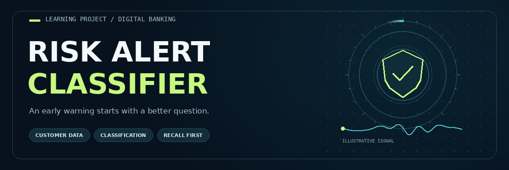
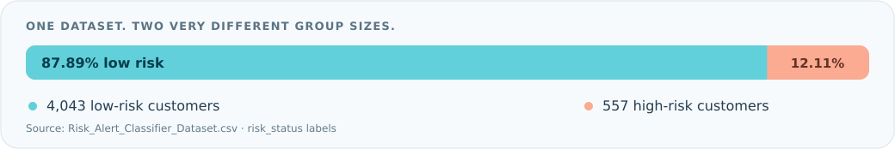
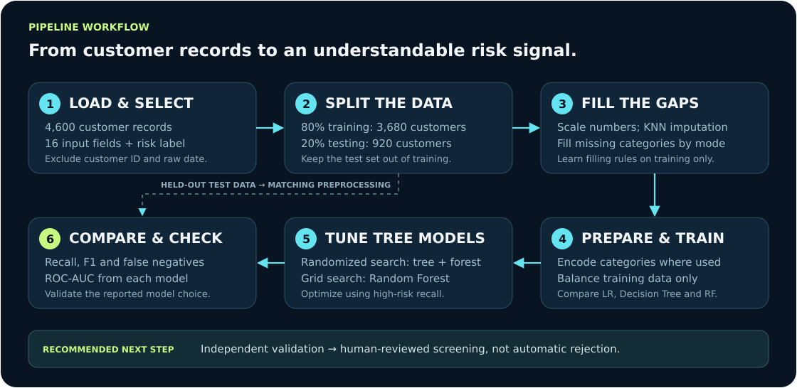
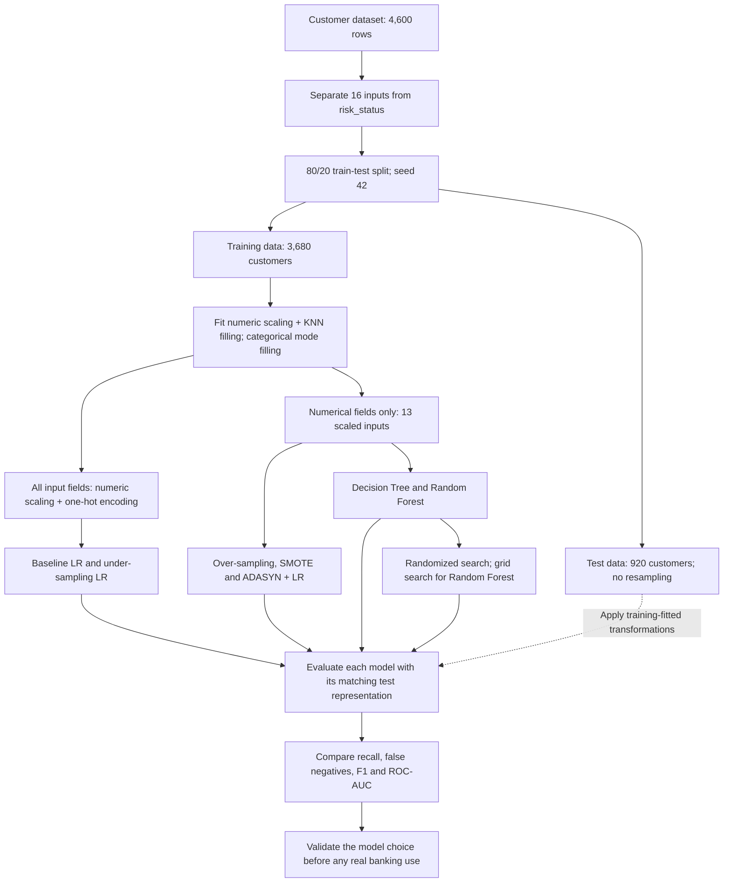
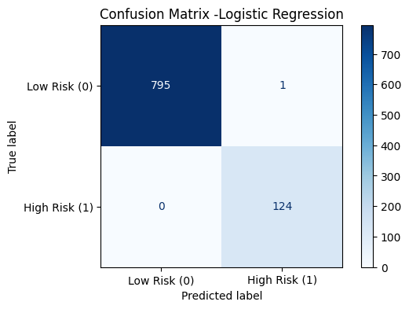
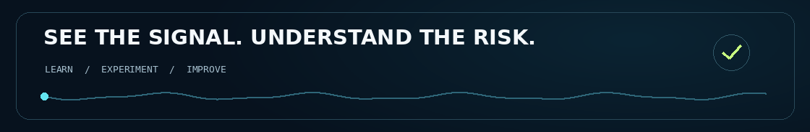

<a id="top"></a>

<div align="center">
  

  <h1>🛡️ Risk Alert Classifier</h1>
  <p><strong>Spot the warning signs. Understand the risk. Make better-informed decisions.</strong></p>
  <p>A beginner-friendly machine learning project for identifying high-risk banking customers.</p>

  

  <br><br>
  <a href="https://github.com/DevanshiCodesAI/Risk_Classifier/blob/main/Risk_Alert_Classifier.ipynb"></a>
  <a href="https://github.com/DevanshiCodesAI/Risk_Classifier/blob/main/Risk_Alert_Classifier_Dataset.csv"></a>
  
  <a href="https://drive.google.com/file/d/13o0Avo_lw_HSmMQB1DDTClFhdK1st6F2/view?usp=sharing"></a>

  <br><br>
  <a href="#overview"></a>
  <a href="#workflow"></a>
  <a href="#results"></a>
  <a href="#key-code"></a>
  <a href="#getting-started"></a>
</div>

---

<a id="overview"></a>

## 💡 The project, in everyday language

Imagine a **smoke alarm for customer risk**. A smoke alarm gives an early warning; it does not prove that a fire has started. Similarly, this project looks for patterns in customer information that may indicate higher financial or behavioral risk.

A bank has records such as payment history, credit usage, income, and transaction activity. The model learns from examples that already have a risk label, then predicts a label for customers in a held-out test set:

| Label | Meaning | Everyday interpretation |
| :---: | --- | --- |
| **0** | Low Risk | The model does not flag this customer for higher risk. This is not a guarantee of safety. |
| **1** | High Risk | The model flags this customer as someone who may need closer review. This is not proof of fraud or future default. |

> **Example:** Missed payments and repeated late payments could be useful clues. The project tests whether customer information helps predict the supplied risk label; it does not use a fixed rule that automatically makes every late-paying customer high risk.

### What is the project trying to achieve?

- **Find more genuinely high-risk customers**, rather than simply getting a high overall score.
- **Handle an uneven dataset**, where low-risk customers greatly outnumber high-risk customers.
- **Compare several learning approaches** and four ways of balancing the training data.
- **Tune model settings** and explain the trade-off between missed risks and unnecessary alerts.

**What it is:** an educational, end-to-end classification notebook.  
**What it is not:** a deployed banking application or a validated system for automatically rejecting customers.

### At a glance

| Item | Details |
| --- | --- |
| Customer records | **4,600** |
| Dataset columns | **19**, including the target, identifier, and date |
| Input fields used | **16 before encoding**: 13 numerical + 3 categorical |
| Target | `risk_status` — 0 = Low Risk, 1 = High Risk |
| Current train/test split | **3,680 training / 920 testing**; seeded 80/20 split |
| Model families | Logistic Regression, Decision Tree, Random Forest |
| Balancing methods | Random under-sampling, random over-sampling, SMOTE, ADASYN |
| Tuning | RandomizedSearchCV for both tree models; GridSearchCV for Random Forest |
| Business priority | Reduce **false negatives**, while keeping false alerts manageable |

<a id="explanation-video"></a>

## 🎬 Explanation video

**Video link: coming soon.** The header button will link to the walkthrough when a video URL is added. Until then, [open the notebook](https://github.com/DevanshiCodesAI/Risk_Classifier/blob/main/Risk_Alert_Classifier.ipynb) or use the [plain-English code guide](#key-code) below.

<!-- Maintainer: after adding a real video link, replace this coming-soon paragraph with a normal Markdown link to the same video. -->

---

## 📦 Understanding the data

Each row represents a customer. Most columns describe the customer; `risk_status` is the answer the model tries to learn.

| Information group | Fields used | What they describe |
| --- | --- | --- |
| Customer profile | `age`, `gender`, `region`, `employment_type` | Basic customer characteristics |
| Financial position | `annual_income_inr`, `debt_balance_inr` | Income and outstanding debt, in INR |
| Credit and repayment | `credit_score`, `credit_utilization_ratio`, `missed_payments_12m`, `avg_late_payment_days` | Credit use and payment behavior |
| Transactions | `monthly_transaction_count`, `monthly_spend_inr`, `cash_advance_count_6m` | Spending and cash-advance activity |
| Account behavior | `complaints_last_6m`, `failed_login_attempts_3m`, `account_tenure_months` | Account activity and relationship history |

The notebook excludes `customer_id` and the raw `last_transaction_date` from the inputs. It also removes `risk_status` from the inputs so the model cannot simply read the answer.

### Why the class imbalance matters

<div align="center">
  
</div>

A model that calls **everyone low risk** would be **87.89% accurate** on the full dataset, yet catch **none** of the high-risk customers. That is why accuracy alone is not enough. This is an illustrative majority-class baseline, **not** the saved Logistic Regression result.

<details>
<summary><strong>Missing values and how they are handled</strong></summary>

| Column | Missing entries |
| --- | ---: |
| `age` | 140 |
| `region` | 102 |
| `employment_type` | 144 |
| `annual_income_inr` | 166 |
| `credit_score` | 216 |
| `credit_utilization_ratio` | 147 |
| `monthly_spend_inr` | 129 |

- **Numerical values:** scale the columns, then use a **KNN Imputer with 5 neighbors**. It estimates a missing value using customers with similar available numerical information.
- **Categories:** fill missing entries with the most frequent category in the training data.
- **Train-only fitting:** learn the scaling and filling rules from the training set, then apply those rules to the test set.
- The baseline/under-sampling preprocessing pipeline also includes median/mode imputers; after the earlier filling step, these normally have no remaining gaps to fill.

</details>

---

<a id="workflow"></a>

## 🔄 Pipeline workflow

<div align="center">
  
</div>

**Important details about the current implementation:**

- The test set is **never resampled**. Model evaluation uses the original held-out customers.
- Baseline and under-sampling Logistic Regression use **all 16 input fields**, with categorical fields one-hot encoded.
- Over-sampling/SMOTE/ADASYN Logistic Regression and the tree models use **13 scaled numerical fields only**. These are not identical feature setups, so differences cannot be attributed to sampling alone.
- The current split uses `random_state=42` but **does not use `stratify=y`**. Adding stratification is a recommended improvement, not an existing feature.

<details>
<summary><strong>View the detailed workflow as a Mermaid diagram</strong></summary>



</details>

---

## 🧠 How the learning methods work

### The three model families

| Model | Simple explanation | Why compare it? |
| --- | --- | --- |
| **Logistic Regression** | Combines customer clues to estimate the probability of the high-risk label. | A useful, relatively interpretable starting point. |
| **Decision Tree** | Asks a sequence of questions, like a flowchart. | Can capture non-linear patterns, but may memorize the training examples. |
| **Random Forest** | Combines the votes of many decision trees. | Often generalizes better than a single tree; this still needs to be measured. |

### The four balancing methods

These methods change the **training examples**, not the real number of risky customers in the test set.

| Technique | In everyday language | Main trade-off |
| --- | --- | --- |
| **Under-sampling** | Use fewer examples of the larger, low-risk group. | Helps equalize attention, but discards some training information. |
| **Over-sampling** | Repeat examples from the smaller, high-risk group. | Keeps majority examples, but may overfit repeated minority examples. |
| **SMOTE** | Create artificial high-risk examples between similar existing ones. | Adds variety, but synthetic examples may not perfectly reflect real customers. |
| **ADASYN** | Create more artificial examples around harder-to-learn minority cases. | Focuses on difficult areas, but can amplify noise. |

**Balancing is an experiment, not a guaranteed improvement.** Its value must be checked against recall, precision, false alerts, and business costs.

---

## 📏 Reading the results without a technical background

| Metric / outcome | The question it answers |
| --- | --- |
| **Accuracy** | Out of all customers, how many labels were correct? |
| **Precision** | Of the customers we flagged, how many were truly high risk? |
| **Recall / TPR** | Of all truly high-risk customers, how many did we catch? |
| **F1-score** | How well do precision and recall work together? |
| **FPR** | Of the truly low-risk customers, how many were incorrectly flagged? |
| **ROC-AUC** | How well do the scores rank high-risk customers above low-risk customers across thresholds? About 0.5 means random ranking; 1.0 means perfect separation on the evaluated data. |
| **False positive — Type I** | An unnecessary alert: a low-risk customer is flagged as high risk. |
| **False negative — Type II** | A missed warning: a high-risk customer is classified as low risk. |

> **Business example:** A false positive can create extra manual review and inconvenience. A false negative can mean a risky account receives no warning. The project prioritizes catching risks, but actual financial costs must be estimated before choosing a final operating threshold.

---

<a id="results"></a>

## 📊 Results reported in the notebook

> **Read these as saved notebook outputs, not independently reproduced results or production guarantees.** The notebook's final written report conflicts with these outputs, and its all-model ROC loop needs correction. The tables below use the individual model sections, **not** the faulty all-model AUC table.

### Logistic Regression: before and after balancing

| Training approach | High-risk recall | F1-score | ROC-AUC |
| --- | ---: | ---: | ---: |
| Baseline, no balancing | 1.0000 | **0.9960** | 1.0000 |
| Random under-sampling | 1.0000 | 0.9688 | 1.0000 |
| Random over-sampling | 1.0000 | 0.9841 | 1.0000 |
| SMOTE | 1.0000 | 0.9880 | 1.0000 |
| ADASYN | 1.0000 | 0.9538 | 1.0000 |

**Simple takeaway:** In these saved results, balancing does **not** improve recall: all five approaches catch every high-risk test customer. The baseline has the highest F1-score. Baseline/under-sampling use categorical information; the other three use numerical fields only, so this is not a controlled comparison of sampling methods.

### Tree models: untuned versus tuned

| Model | Test accuracy | High-risk recall | F1-score | ROC-AUC |
| --- | ---: | ---: | ---: | ---: |
| Decision Tree | 0.9620 | 0.8629 | 0.8594 | — |
| Random Forest | 0.9880 | 0.9274 | 0.9544 | 0.9996 |
| Decision Tree — randomized search | 0.9739 | 0.8790 | 0.9008 | — |
| Random Forest — randomized search | 0.9913 | 0.9435 | 0.9669 | — |
| Random Forest — grid search | **0.9924** | **0.9516** | **0.9712** | 0.9997 |

“—” means the individual section does not report that value; it is not zero. The untuned Decision Tree and Random Forest both report training accuracy of 1.0000. Their train/test gaps are **0.0380** and **0.0120**, respectively, suggesting better generalization for the forest on this split.

**Simple takeaway:** The saved outputs show better test performance after tuning the tree models. They do not establish that a tuned tree model is the best overall choice.

<details>
<summary><strong>See the saved confusion matrices and actual error counts</strong></summary>

These screenshots were extracted from the notebook's saved outputs; they were not generated by a new run.

| Saved result | Correct low-risk: TN | False alerts: FP | Missed risks: FN | Correct high-risk: TP |
| --- | ---: | ---: | ---: | ---: |
| Baseline Logistic Regression | 795 | **1** | **0** | 124 |
| Under-sampling Logistic Regression | 788 | **8** | **0** | 124 |

**In everyday language:** Both catch all 124 high-risk test customers. The baseline unnecessarily flags 1 low-risk customer; under-sampling flags 8. This is why under-sampling cannot be called the clear winner from these saved results.

<p align="center">
  
  
</p>

</details>

### Important validation notes

1. **The written conclusion is inconsistent.** Part H selects under-sampling LR and quotes recall of 0.4919, but the saved under-sampling output shows 1.0000. Its stated error counts also differ from the saved confusion matrix. Refresh the report after rerunning the notebook.
2. **The all-model ROC/AUC comparison is not reliable.** Its loops reuse the same `y_prob` instead of calculating each model's own probabilities. A corrected example is included below.
3. **The feature inputs differ across experiments.** Use a consistent feature/preprocessing setup before making a fair comparison of sampling methods and models.
4. **Cross-validation should include preprocessing.** Numeric scaling and KNN filling are done before the tree-model searches. Move these steps inside the searched pipeline so each fold learns them only from its own training portion.
5. **A final winner needs fresh validation.** The notebook manually selects under-sampling LR; the saved outputs do not justify calling it uniquely best. Validate feature timing, check for leakage, use stratification, and confirm performance on independent data before making banking decisions.

---

<a id="key-code"></a>

## 👩‍💻 Main code, explained simply

The first nine examples are excerpts or shortened versions of the notebook's current approach. Each includes a plain-English explanation of **what the code does and why it matters**. They are a code-reading guide, not a standalone script, and use variables created by earlier notebook cells. Example 10 is a **suggested correction**, not a change already made to the repository.

### 1 · Separate the clues from the answer

```python
import pandas as pd

df = pd.read_csv("Risk_Alert_Classifier_Dataset.csv")

X = df.drop(
    columns=["risk_status", "customer_id", "last_transaction_date"],
    errors="ignore"
)
y = df["risk_status"].astype(int)
```

**Plain English:** `X` holds the customer information, like the clues on a form. `y` holds the known risk label, like the answer key. The identifier and raw date are excluded, and the answer is never used as an input.


### 2 · Learn from some customers; test on different customers

```python
from sklearn.model_selection import train_test_split

X_train, X_test, y_train, y_test = train_test_split(
    X, y, test_size=0.20, random_state=42
)
```

**Plain English:** The model learns from 80% of the records. The remaining 20% are set aside to check whether it can handle customers it did not train on. `random_state=42` makes the random split repeatable.

**Recommended improvement:** add `stratify=y` to the call to preserve the overall class proportions more closely. This will change the split and requires rerunning all later results.


### 3 · Fill missing numbers using similar customers

```python
from sklearn.impute import KNNImputer
from sklearn.preprocessing import StandardScaler

numeric_columns = X_train.select_dtypes(include=["number"]).columns

std_scaler = StandardScaler()
X_train_scaled = std_scaler.fit_transform(X_train[numeric_columns])
X_test_scaled = std_scaler.transform(X_test[numeric_columns])

imputer = KNNImputer(n_neighbors=5)
X_train_imputed = imputer.fit_transform(X_train_scaled)
X_test_imputed = imputer.transform(X_test_scaled)

# Put the filled numbers back into the customer tables.
X_train[numeric_columns] = std_scaler.inverse_transform(X_train_imputed)
X_test[numeric_columns] = std_scaler.inverse_transform(X_test_imputed)

# Keep a complete, scaled numerical version for later models.
X_train_scaled = std_scaler.fit_transform(X_train[numeric_columns])
X_test_scaled = std_scaler.transform(X_test[numeric_columns])
```

**Plain English:** First, put different numerical columns on comparable scales so a rupee amount does not dominate an age value when measuring similarity. Then use five nearby examples to estimate missing numbers. The notebook converts the filled values back to the original scale, then re-scales its fully imputed numerical data for later models.

`fit_transform` learns the rules from training data. `transform` applies the already-learned rules to test data.


### 4 · Convert customer information into a baseline prediction

```python
from sklearn.compose import ColumnTransformer
from sklearn.pipeline import Pipeline
from sklearn.preprocessing import OneHotEncoder
from sklearn.impute import SimpleImputer
from sklearn.linear_model import LogisticRegression

number_columns = X_train.select_dtypes(include="number").columns.tolist()
text_columns = X_train.select_dtypes(exclude="number").columns.tolist()

number_steps = Pipeline([
    ("fill_missing", SimpleImputer(strategy="median")),
    ("scale_values", StandardScaler())
])
text_steps = Pipeline([
    ("fill_missing", SimpleImputer(strategy="most_frequent")),
    ("convert_to_numbers", OneHotEncoder(handle_unknown="ignore"))
])

prepare_data = ColumnTransformer([
    ("numbers", number_steps, number_columns),
    ("text", text_steps, text_columns)
])
model = Pipeline([
    ("data_preparation", prepare_data),
    ("prediction", LogisticRegression(max_iter=2000))
])
model.fit(X_train, y_train)
```

**Plain English:** Numbers are scaled. Categories such as region are turned into yes/no indicator columns. `ColumnTransformer` sends each type of information through the right preparation steps, and `Pipeline` connects preparation to prediction.

`max_iter=2000` allows enough optimization iterations; it does **not** mean 2,000 customers or trees.


### 5 · Give the smaller class more attention during training

```python
from imblearn.pipeline import Pipeline as ImbPipeline
from imblearn.under_sampling import RandomUnderSampler

model_under = ImbPipeline([
    ("prepare_data", prepare_data),
    ("under_sampler", RandomUnderSampler(random_state=42)),
    ("classifier", LogisticRegression(random_state=42, max_iter=2000))
])
model_under.fit(X_train, y_train)
pred_under = model_under.predict(X_test)
```

**Plain English:** Prepare the information, select a smaller set of low-risk training examples, then train Logistic Regression on the balanced selection. The `imblearn` pipeline applies sampling during fitting, not when predicting the test customers.

**Small code-reading tip:** Printing the original `y_train.value_counts()` after fitting this pipeline still shows the original distribution. It does not show the sampler's internal balanced labels.


### 6 · Create synthetic training examples with SMOTE

```python
from imblearn.over_sampling import SMOTE

smote = SMOTE(random_state=42)
X_train_smote, y_train_smote = smote.fit_resample(
    X_train_scaled, y_train
)

model_smote = LogisticRegression(random_state=42)
model_smote.fit(X_train_smote, y_train_smote)
pred_smote = model_smote.predict(X_test_scaled)
```

**What it does:** SMOTE adds artificial examples to the smaller high-risk training group. It creates points between similar existing minority-class examples, then trains Logistic Regression on that expanded training set.

**Why it matters:** The model has more minority-class examples to learn from. However, the new examples are **not real customers**, and this does not guarantee better results. The test set stays unchanged so the evaluation remains realistic.

**Project-specific detail:** This SMOTE experiment uses the **13 scaled numerical fields**, unlike the baseline that also uses categorical information.

### 7 · Compare a single tree with a forest of trees

```python
from sklearn.tree import DecisionTreeClassifier
from sklearn.ensemble import RandomForestClassifier

dt_model = DecisionTreeClassifier(random_state=42)
dt_model.fit(X_train_scaled, y_train)
dt_test_pred = dt_model.predict(X_test_scaled)

rf_model = RandomForestClassifier(n_estimators=100, random_state=42)
rf_model.fit(X_train_scaled, y_train)
rf_test_pred = rf_model.predict(X_test_scaled)
```

**What it does:** The Decision Tree learns a sequence of questions about customer information. The Random Forest builds **100 trees** and combines their predictions.

**Why it matters:** A single tree can memorize the training records. Combining many trees can make predictions more stable, but the project checks that using held-out test customers rather than assuming the forest is always better.

`fit(...)` means **learn from the training examples**. `predict(...)` means **use what was learned to assign risk labels**.

### 8 · Try different model settings and prioritize catching risks

```python
from sklearn.model_selection import RandomizedSearchCV

rf_params = {
    "n_estimators": [100, 200, 300, 400],
    "max_depth": [5, 10, 15, 20, None],
    "min_samples_split": [2, 5, 10],
    "min_samples_leaf": [1, 2, 4],
    "criterion": ["gini", "entropy"]
}
rf_random = RandomizedSearchCV(
    RandomForestClassifier(random_state=42),
    rf_params,
    n_iter=20, cv=5, scoring="recall",
    random_state=42, n_jobs=-1
)
rf_random.fit(X_train_scaled, y_train)
best_rf = rf_random.best_estimator_
```

**Plain English:** Try 20 combinations of forest settings. Test each using five internal training/validation folds. Prefer settings that catch more high-risk customers because `scoring="recall"` matches the project's priority.

- `n_estimators`: how many trees vote.
- `max_depth`: how many levels a tree can grow.
- `min_samples_split` / `min_samples_leaf`: how many examples are required before splitting or keeping a final branch.
- `n_jobs=-1`: use the available CPU cores.

The notebook also runs randomized search for the Decision Tree, then **GridSearchCV** for Random Forest. Randomized search tries selected combinations; grid search tries every combination in its defined grid. For safer validation, put preprocessing inside the cross-validation pipeline rather than fitting it beforehand.


### 9 · Count correct predictions, false alerts, and missed risks

```python
from sklearn.metrics import (
    confusion_matrix, accuracy_score, precision_score,
    recall_score, f1_score
)

# Here, model is the baseline pipeline created in example 4.
y_pred = model.predict(X_test)
cm = confusion_matrix(y_test, y_pred)
tn, fp, fn, tp = cm.ravel()

print(f"Accuracy: {accuracy_score(y_test, y_pred):.4f}")
print(f"Precision: {precision_score(y_test, y_pred):.4f}")
print(f"Recall: {recall_score(y_test, y_pred):.4f}")
print(f"F1-score: {f1_score(y_test, y_pred):.4f}")
print(f"False alerts: {fp}; missed high-risk customers: {fn}")
```

**What it does:** Compare the predicted labels against the known test labels and count each kind of outcome.

| Code value | Plain-English meaning |
| --- | --- |
| `tn` | Low-risk customers correctly left unflagged |
| `fp` | Low-risk customers incorrectly flagged — Type I error |
| `fn` | High-risk customers missed by the model — Type II error |
| `tp` | High-risk customers correctly flagged |

**Why it matters:** In this project, `fn` is especially important because it counts missed warnings. Recall shows how many actual high-risk customers were caught, while precision shows how trustworthy the alerts were. Accuracy alone can hide poor detection of the minority class.

### 10 · Suggested fix: calculate separate ROC scores for every model

The current ROC loops reuse `y_prob`, so different model names can be attached to the same probability vector. Use each estimator's own predictions and the correct input format instead:

```python
import matplotlib.pyplot as plt
from sklearn.metrics import roc_curve, roc_auc_score

raw_input_models = {"Baseline LR", "Under-Sampling LR"}
auc_rows = []
plt.figure(figsize=(10, 7))

for name, estimator in all_models.items():
    test_data = X_test if name in raw_input_models else X_test_scaled
    probabilities = estimator.predict_proba(test_data)[:, 1]

    fpr, tpr, _ = roc_curve(y_test, probabilities)
    score = roc_auc_score(y_test, probabilities)
    auc_rows.append({"Model": name, "AUC-ROC": score})
    plt.plot(fpr, tpr, label=f"{name} (AUC = {score:.3f})")

plt.plot([0, 1], [0, 1], "k--", label="Random ranking")
plt.xlabel("False Positive Rate")
plt.ylabel("True Positive Rate / Recall")
plt.legend(loc="lower right")
plt.show()

auc_table = pd.DataFrame(auc_rows).sort_values(
    "AUC-ROC", ascending=False
)
print(auc_table.round(4).to_string(index=False))
```

**Plain English:** Give every model its own test paper and its own score. `[:, 1]` selects the probability of class **1 — High Risk**, which is what the ROC calculation needs. This snippet assumes the notebook's earlier imports and `all_models` dictionary exist.


---

<a id="getting-started"></a>

## 🚀 Run the project locally

### 1. Download the repository

```bash
git clone https://github.com/DevanshiCodesAI/Risk_Classifier.git
cd Risk_Classifier
```

### 2. Create and activate an environment

```bash
python -m venv .venv
```

**macOS / Linux:**

```bash
source .venv/bin/activate
```

**Windows PowerShell:**

```powershell
.venv\Scripts\Activate.ps1
```

### 3. Install the required packages

```bash
python -m pip install --upgrade pip
python -m pip install pandas numpy matplotlib scikit-learn imbalanced-learn jupyter
```

The source notebook records **Python 3.13.5** in its metadata. The repository currently has no dependency lockfile, so exact package versions and outputs may vary by environment. `imbalanced-learn` is the package name; its Python import is `imblearn`.

### 4. Open the notebook

```bash
jupyter notebook Risk_Alert_Classifier.ipynb
```

Keep `Risk_Alert_Classifier_Dataset.csv` in the same working folder as the notebook. Restart the kernel and run the cells in order. Hyperparameter searches perform many model fits, so they take longer than the initial data-preparation cells.

**Before using the final comparison:** correct the ROC loops and update the written conclusions to match the newly generated outputs.

---

## 🗂️ Repository layout

After adding this README and its supplied assets:

```text
Risk_Classifier/
├── README.md
├── Risk_Alert_Classifier.ipynb
├── Risk_Alert_Classifier_Dataset.csv
└── assets/
    ├── header.gif
    ├── footer.gif
    ├── workflow.svg
    ├── class-distribution.svg
    ├── tech-stack.svg
    ├── button-*.svg
    ├── baseline-confusion-matrix.png
    └── under-sampling-confusion-matrix.png
```

### Notebook coverage

| Part | What it covers |
| --- | --- |
| **A — Theory** | Classification, metrics, error types, ROC-AUC, class imbalance |
| **B — Preparation** | Feature/target separation, train/test split, KNN and categorical imputation |
| **C — Baseline** | Logistic Regression, confusion matrix, accuracy, precision, recall, F1 |
| **D — Imbalance** | Under-sampling, over-sampling, SMOTE, ADASYN |
| **E — Trees** | Decision Tree, Random Forest, train/test performance gaps |
| **F — Tuning** | RandomizedSearchCV and GridSearchCV with recall scoring |
| **G — Evaluation** | ROC analysis and manual model selection; ROC comparison requires correction |
| **H — Reporting** | Business interpretation and recommendations; narrative needs alignment with outputs |

---

## 🌱 Next steps and responsible use

- [ ] Add `stratify=y` and rerun the full notebook.
- [ ] Use the same features across sampling comparisons.
- [ ] Keep preprocessing and any resampling inside training/CV pipelines.
- [ ] Correct the ROC/AUC loops and refresh the final report.
- [ ] Add a reproducible dependency file and an independent validation set.
- [ ] Compare precision–recall curves / average precision alongside ROC-AUC.
- [ ] Choose a decision threshold using validation data, estimated error costs, and the team's review capacity—not the final test set.
- [ ] Evaluate performance across customer groups and review whether demographic features should be used.
- [ ] Check that every input would be available **before** the risk decision is made.
- [ ] If taken beyond a learning exercise, protect customer data, monitor changing behavior, and require human review rather than automatic denial based only on a label.

**Bottom line:** The goal is not just a high accuracy number. It is an understandable, well-validated warning system that catches important risks without creating unnecessary harm.

---

<div align="center">
  
  <br><br>
  <a href="#top"></a>
  <a href="https://github.com/DevanshiCodesAI/Risk_Classifier"></a>
  <br><br>
  <strong>Created by <a href="https://github.com/DevanshiCodesAI">DevanshiCodesAI</a></strong><br>
  <sub>If this project helped you understand machine learning for risk detection, consider giving the repository a ⭐.</sub>
</div>
